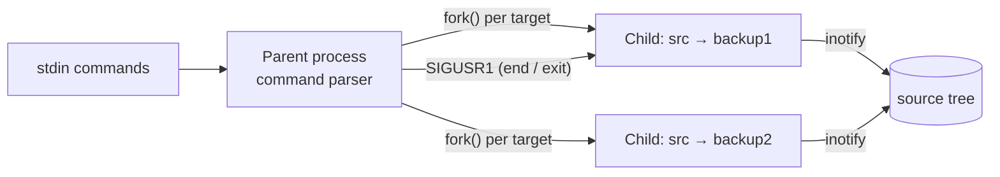

# Live Backup Manager

A real-time directory backup tool for Linux, written in C. It mirrors a source directory to one or more backup directories and keeps them in sync as files change, using the Linux **inotify** API. Each backup runs in its own process, so several backups can be active at once, and any stopped backup can be used to restore the source.

Built for the Operating Systems course at Warsaw University of Technology.

## Features

- **Live mirroring** – creates, edits, deletes, renames and moves (of files and whole subtrees) are applied to the backup as they happen.
- **Several targets at once** – `add` takes one source and any number of targets; each target is synced by a separate child process.
- **Recursive watching** – every directory in the tree gets its own inotify watch. New or moved-in subdirectories are copied and watched; moved-out ones are removed and their watches dropped.
- **Symlink-aware copying** – absolute links that point inside the source tree are rewritten to point inside the backup; all other links are copied as they are.
- **Permissions preserved** – files and directories keep their mode bits.
- **Snapshots and restore** – `end` stops syncing but keeps the copy; `restore` rebuilds the source from that copy and then restarts the active backups.
- **Safe I/O** – reads and writes loop over partial transfers and retry on `EINTR`; editor temp files (`*~`) are skipped.

## How it works



1. **Initial copy.** `add` checks the target is missing or empty, copies the whole tree, then `fork()`s a child for that target.
2. **Sync loop.** The child adds recursive watches (`IN_CREATE`, `IN_DELETE`, `IN_CLOSE_WRITE`, `IN_MOVED_FROM`, `IN_MOVED_TO`, `IN_ATTRIB`). It keeps a watch-descriptor → path map, so each event is translated to the matching path in the backup.
3. **Stopping.** `end` sends `SIGUSR1` to that child. The child finishes cleanly and the copy is kept as a deactivated snapshot.
4. **Process management.** The parent ignores every signal except `SIGINT`/`SIGTERM`, reaps finished children with `waitpid(WNOHANG)`, and on `exit` signals the whole process group and waits for every child.

## Build

Linux only, because inotify is a Linux API.

```bash
gcc -std=gnu11 -Wall -O2 -o backup src/*.c
```

## Usage

Start the program and type commands:

```text
$ ./backup
add <source> <target> [<target> ...]   start backing up source into one or more targets
end <source> <target> [<target> ...]   stop the given backups (copies are kept)
list                                   show active and deactivated backups
restore <source> <target>              rebuild source from a deactivated backup
exit                                   stop all backups and quit
```

Put paths that contain spaces in double quotes, e.g. `add "My Documents" backup`. Paths with shell metacharacters (`& | ; $ < > ( ) { }` and backticks) are rejected.

### Example

```text
add src backup1 backup2         # copies src twice and starts two watchers
                                # ...edit files in src: both backups follow
end src backup2                 # backup2 is now a frozen snapshot
                                # ...more changes go to backup1 only
restore src backup2             # src is rolled back to the snapshot
exit
```

## Limits

| | |
|---|---|
| Concurrent backups | 30 |
| Watched directories per backup | 8192 |
| Copy buffer | 8 KiB |

A changed file is copied again in full; the tool does not send only the changed parts.

## Project structure

```
src/
├── main.c                  # entry point, signal setup, main loop, child reaping
├── processing_commands.c   # command parsing (quoted paths), add / end / list / restore / exit
├── add.c                   # per-backup child: inotify watches and event handling
└── copying.c               # recursive tree copy, file and symlink copying, buffered I/O
```
